<div align="center">

<a href="https://audiocn-solid.jhonra121.workers.dev">
  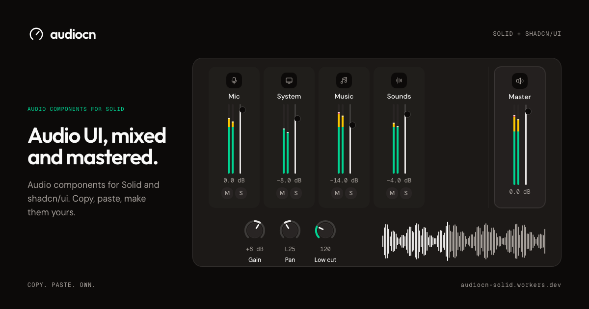
</a>

<p><strong>Audio components for Solid, built the shadcn way.</strong><br />
Level meters, visualizers, faders, knobs, channel strips, a complete mixer, players and sound pads.<br />
Copy, paste, make them yours.</p>
<p>A Solid port of <a href="https://github.com/audiocn/ui">audiocn/ui</a>.</p>

<p>
  <a href="https://audiocn-solid.jhonra121.workers.dev/docs/components"></a>
  <a href="https://audiocn-solid.jhonra121.workers.dev/docs/blocks"></a>
  <a href="https://audiocn-solid.jhonra121.workers.dev/docs/hooks/use-audio-analyser"></a>
  <a href="./license.md"></a>
</p>

<p>
  <a href="https://www.solidjs.com"></a>
  <a href="https://ui.shadcn.com/docs/registry"></a>
  <a href="https://tailwindcss.com"></a>
  <a href="https://developer.mozilla.org/docs/Web/API/Web_Audio_API"></a>
</p>

<p>
  <a href="https://audiocn-solid.jhonra121.workers.dev/docs"><strong>Docs</strong></a> ·
  <a href="https://audiocn-solid.jhonra121.workers.dev/docs/installation"><strong>Installation</strong></a> ·
  <a href="https://audiocn-solid.jhonra121.workers.dev/docs/components"><strong>Components</strong></a> ·
  <a href="https://audiocn-solid.jhonra121.workers.dev/docs/blocks"><strong>Blocks</strong></a> ·
  <a href="https://audiocn-solid.jhonra121.workers.dev/docs/concepts/theming"><strong>Theming</strong></a>
</p>

</div>

## Why audiocn

- **You own the code.** audiocn is not a runtime component package. The shadcn CLI copies source into your project, where you can change anything.
- **Themed by shadcn.** Styled with Tailwind CSS and the standard shadcn CSS variables. Your theme styles the components.
- **Meters and visualizers** draw on animation frames using canvas or DOM updates.
- **Bring your own audio.** Components receive levels and values; they never open a microphone themselves. Use the included Web Audio hooks, or feed them from another engine.
- **Real units.** Mixer components speak decibels, the way audio engineers do.
- **Accessible.** Keyboard control, ARIA roles and reduced-motion support are built in.

## Components

<table>
  <tr>
    <td width="50%"><a href="https://audiocn-solid.jhonra121.workers.dev/docs/components/mixer">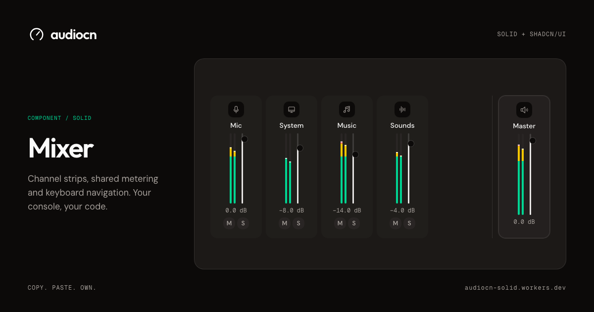</a></td>
    <td width="50%"><a href="https://audiocn-solid.jhonra121.workers.dev/docs/components/level-meter">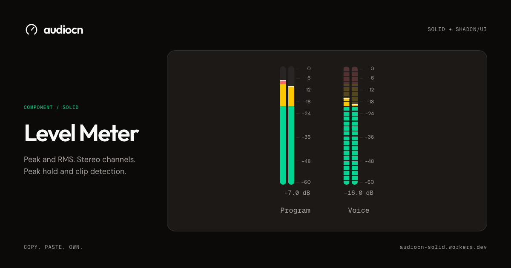</a></td>
  </tr>
  <tr>
    <td width="50%"><a href="https://audiocn-solid.jhonra121.workers.dev/docs/components/knob">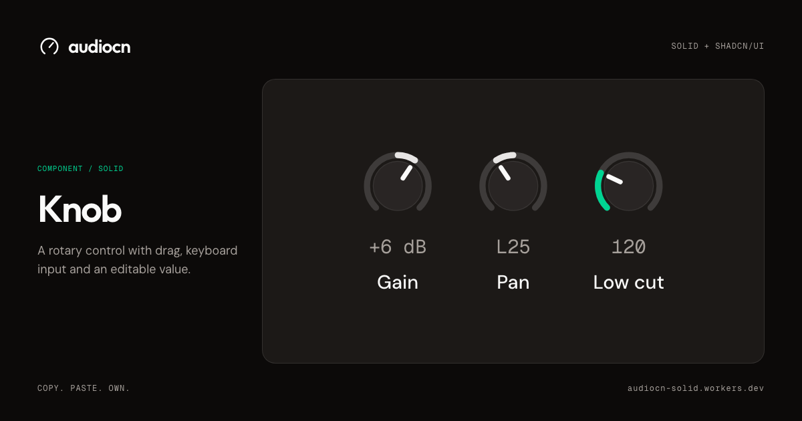</a></td>
    <td width="50%"><a href="https://audiocn-solid.jhonra121.workers.dev/docs/components/waveform">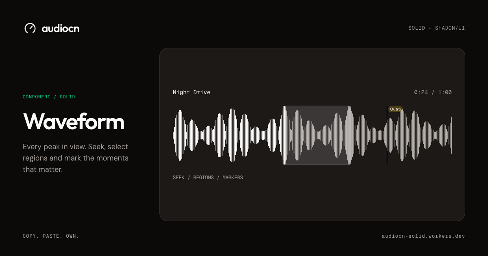</a></td>
  </tr>
  <tr>
    <td width="50%"><a href="https://audiocn-solid.jhonra121.workers.dev/docs/components/electric-waveform">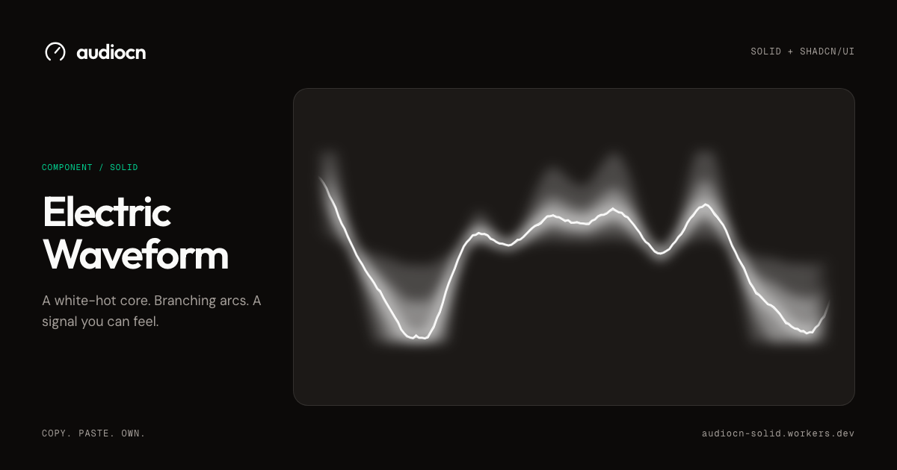</a></td>
    <td width="50%"><a href="https://audiocn-solid.jhonra121.workers.dev/docs/components/electric-bar-visualizer">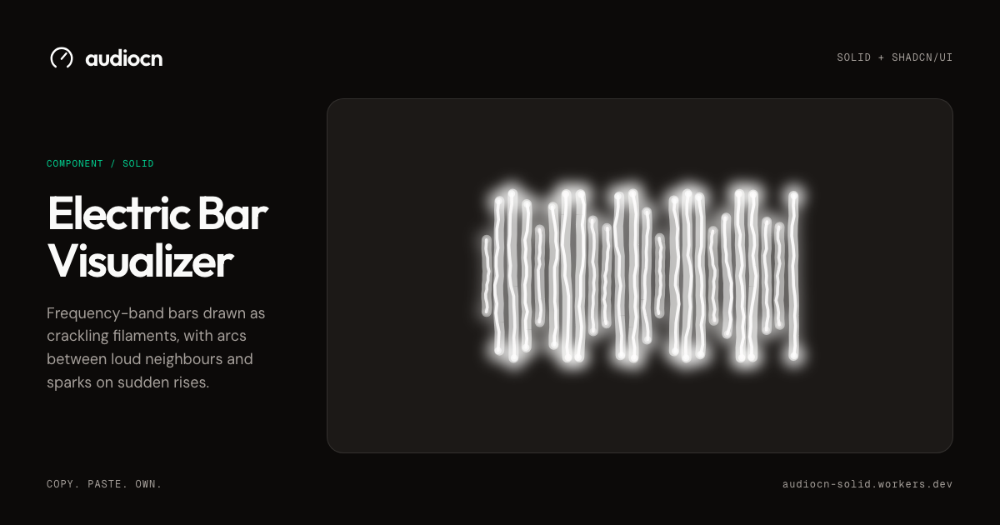</a></td>
  </tr>
  <tr>
    <td width="50%"><a href="https://audiocn-solid.jhonra121.workers.dev/docs/components/spectrum">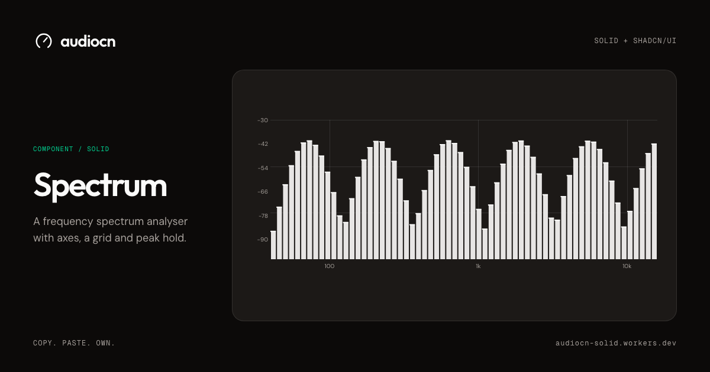</a></td>
    <td width="50%"><a href="https://audiocn-solid.jhonra121.workers.dev/docs/components/smooth-waveform">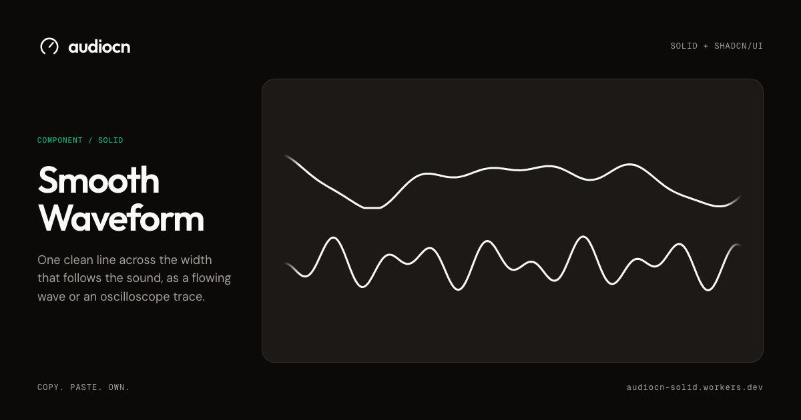</a></td>
  </tr>
  <tr>
    <td width="50%"><a href="https://audiocn-solid.jhonra121.workers.dev/docs/components/audio-player">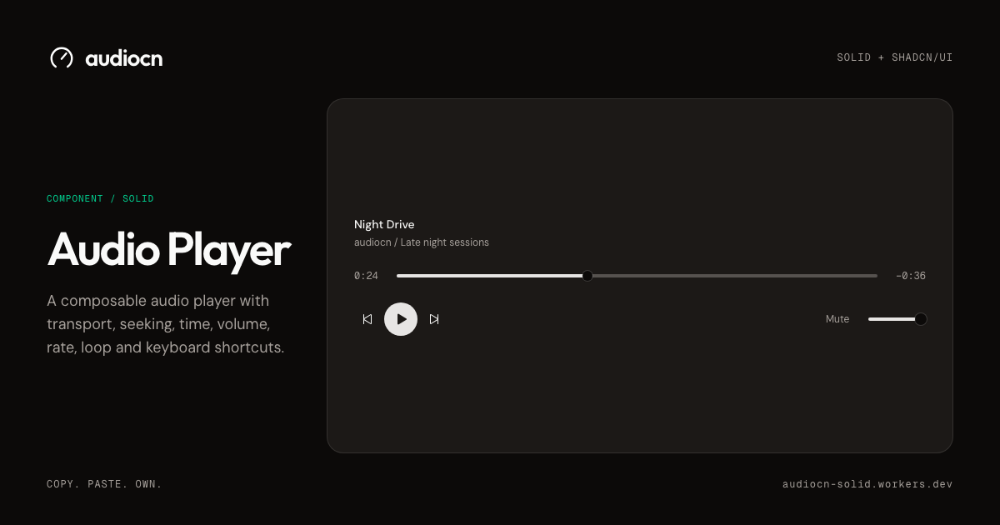</a></td>
    <td width="50%"><a href="https://audiocn-solid.jhonra121.workers.dev/docs/components/sound-pad">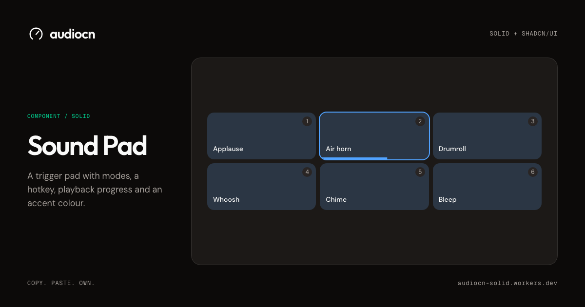</a></td>
  </tr>
</table>

<details>
<summary><strong>All 23 components</strong></summary>

<br />

**Meters and visualizers**

| Component | What it does |
| --- | --- |
| [Level Meter](https://audiocn-solid.jhonra121.workers.dev/docs/components/level-meter) | Peak and RMS meter with zones, peak hold, a scale, readout and clip light |
| [dB Scale](https://audiocn-solid.jhonra121.workers.dev/docs/components/db-scale) | Tick marks and labels for decibel ranges |
| [dB Readout](https://audiocn-solid.jhonra121.workers.dev/docs/components/db-readout) | Numeric level label that updates at a readable rate |
| [Clip Indicator](https://audiocn-solid.jhonra121.workers.dev/docs/components/clip-indicator) | Latched clip light with a count and reset |
| [Bar Visualizer](https://audiocn-solid.jhonra121.workers.dev/docs/components/bar-visualizer) | Frequency-band bars with idle, loading and mirrored modes |
| [Electric Bar Visualizer](https://audiocn-solid.jhonra121.workers.dev/docs/components/electric-bar-visualizer) | Crackling frequency bars with arcs and sparks |
| [Electric Waveform](https://audiocn-solid.jhonra121.workers.dev/docs/components/electric-waveform) | Glowing waveform with a bright core, forks and sparks |
| [Smooth Waveform](https://audiocn-solid.jhonra121.workers.dev/docs/components/smooth-waveform) | Flowing waveform or oscilloscope trace |
| [Live Waveform](https://audiocn-solid.jhonra121.workers.dev/docs/components/live-waveform) | Canvas waveform of a live signal |
| [Waveform](https://audiocn-solid.jhonra121.workers.dev/docs/components/waveform) | Clip waveform with playhead, seeking, regions and markers |
| [Spectrum](https://audiocn-solid.jhonra121.workers.dev/docs/components/spectrum) | Frequency analyser with axes, grid and peak hold |

**Controls**

| Component | What it does |
| --- | --- |
| [Fader](https://audiocn-solid.jhonra121.workers.dev/docs/components/fader) | Decibel volume fader with tapers, detents, scale and reset |
| [Parameter Slider](https://audiocn-solid.jhonra121.workers.dev/docs/components/parameter-slider) | Labelled slider with numeric input, unit, marks and reset |
| [Knob](https://audiocn-solid.jhonra121.workers.dev/docs/components/knob) | Rotary control for dense layouts |
| [LCD Display](https://audiocn-solid.jhonra121.workers.dev/docs/components/lcd-display) | Themeable dot-matrix screen with dropdown rows |
| [Pan Control](https://audiocn-solid.jhonra121.workers.dev/docs/components/pan-control) | Left-right balance with centre detent |
| [Channel Toggle](https://audiocn-solid.jhonra121.workers.dev/docs/components/channel-toggle) | Mute, solo and monitor buttons |
| [Volume Control](https://audiocn-solid.jhonra121.workers.dev/docs/components/volume-control) | Volume slider with mute button |
| [Audio Device Select](https://audiocn-solid.jhonra121.workers.dev/docs/components/audio-device-select) | Microphone, speaker or source picker |

**Mixer**

| Component | What it does |
| --- | --- |
| [Channel Strip](https://audiocn-solid.jhonra121.workers.dev/docs/components/channel-strip) | Mixer channel composed from the parts you need |
| [Mixer](https://audiocn-solid.jhonra121.workers.dev/docs/components/mixer) | Channel strips with shared meter settings and keyboard navigation |

**Sounds and music**

| Component | What it does |
| --- | --- |
| [Audio Player](https://audiocn-solid.jhonra121.workers.dev/docs/components/audio-player) | Composable player with transport, seeking, volume, rate and loop |
| [Track List](https://audiocn-solid.jhonra121.workers.dev/docs/components/track-list) | Tracks with active and playing states and arrow-key navigation |
| [Sound Pad](https://audiocn-solid.jhonra121.workers.dev/docs/components/sound-pad) | Trigger pad with modes, hotkey and playback progress |

</details>

## Blocks

Blocks combine components into complete audio features.

<table>
  <tr>
    <td width="50%"><a href="https://audiocn-solid.jhonra121.workers.dev/docs/blocks/system-audio-mixer">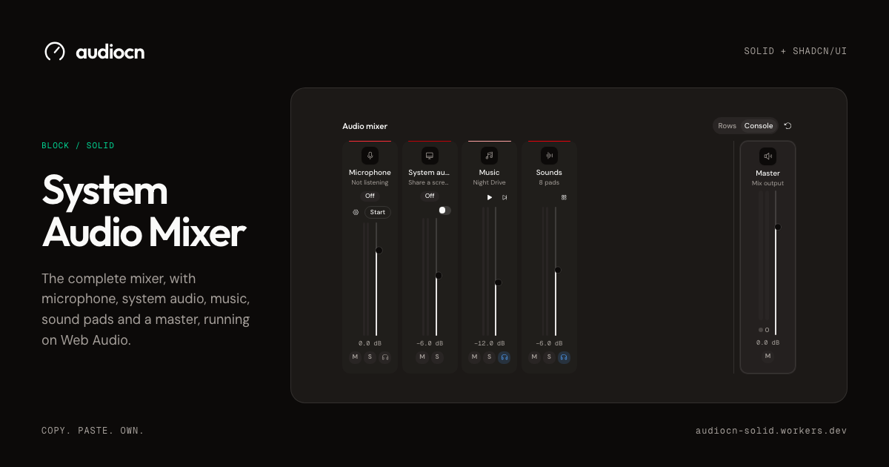</a></td>
    <td width="50%"><a href="https://audiocn-solid.jhonra121.workers.dev/docs/blocks/music-player">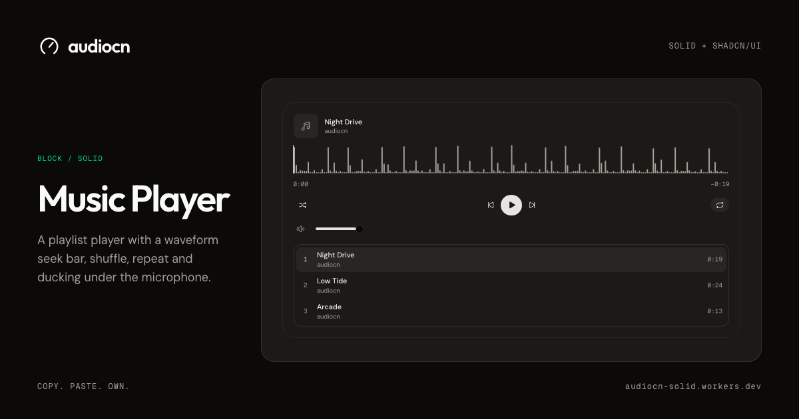</a></td>
  </tr>
  <tr>
    <td width="50%"><a href="https://audiocn-solid.jhonra121.workers.dev/docs/blocks/soundboard">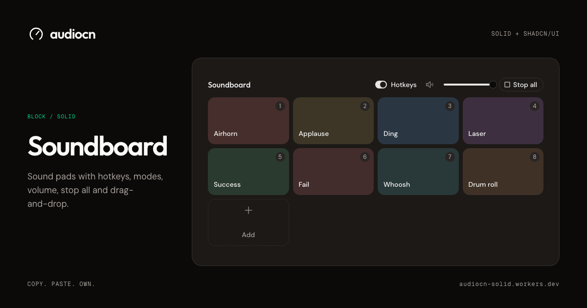</a></td>
    <td width="50%"><a href="https://audiocn-solid.jhonra121.workers.dev/docs/blocks/mic-setup">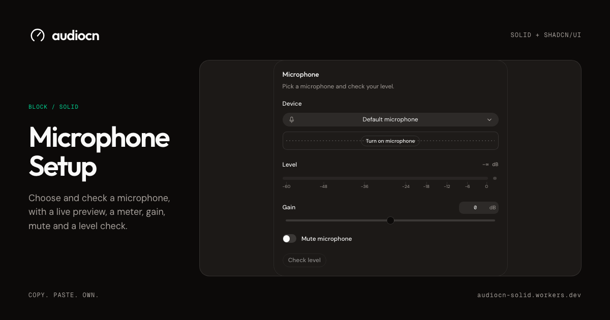</a></td>
  </tr>
  <tr>
    <td width="50%"><a href="https://audiocn-solid.jhonra121.workers.dev/docs/blocks/quick-audio-popover">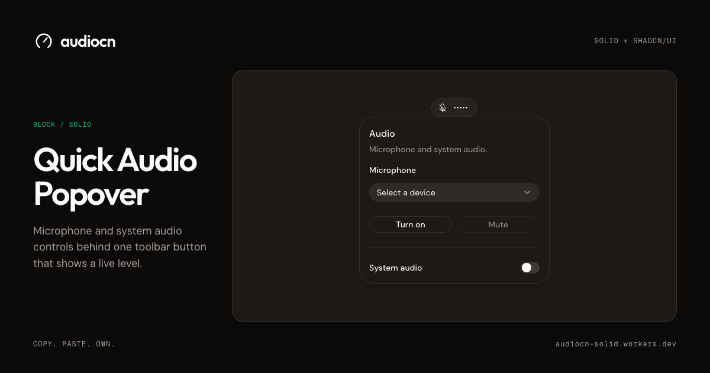</a></td>
    <td width="50%"><a href="https://audiocn-solid.jhonra121.workers.dev/docs/blocks/system-audio-settings">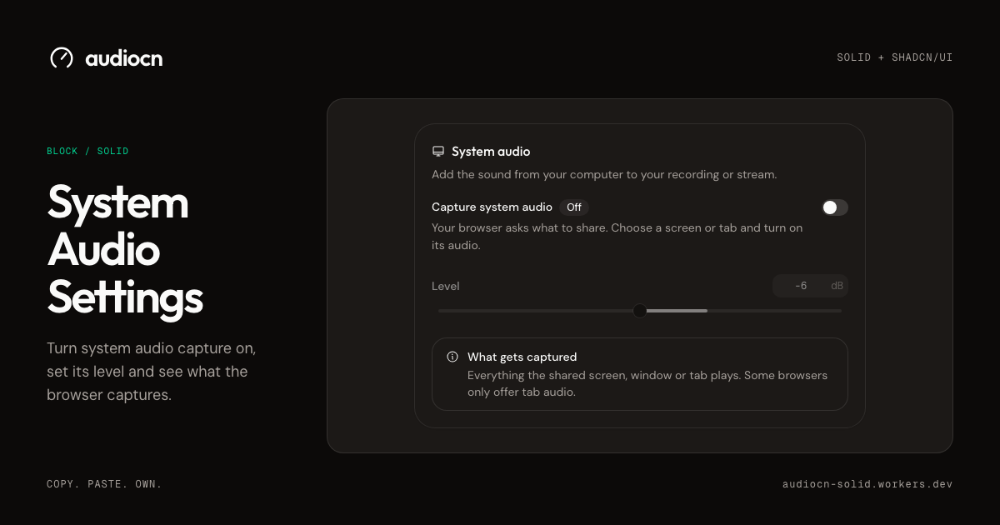</a></td>
  </tr>
</table>

## Hooks

Web Audio hooks provide levels and playback state to components. You can also provide data from another audio engine.

| Hook | What it does |
| --- | --- |
| [`useMicrophone`](https://audiocn-solid.jhonra121.workers.dev/docs/hooks/use-microphone) | Open a microphone as a `MediaStream` |
| [`useSystemAudio`](https://audiocn-solid.jhonra121.workers.dev/docs/hooks/use-system-audio) | Capture system or tab audio through the browser's share picker |
| [`useAudioAnalyser`](https://audiocn-solid.jhonra121.workers.dev/docs/hooks/use-audio-analyser) | Meter and visualize streams, media elements or `AudioNode`s |
| [`useWebAudioMixer`](https://audiocn-solid.jhonra121.workers.dev/docs/hooks/use-web-audio-mixer) | Bind mixer state to a Web Audio graph |
| [`useMixer`](https://audiocn-solid.jhonra121.workers.dev/docs/hooks/use-mixer) | Gain, mute, solo, pan and monitor state |
| [`useAudioPlayer`](https://audiocn-solid.jhonra121.workers.dev/docs/hooks/use-audio-player) | Playback state for an owned audio element |
| [`useSound`](https://audiocn-solid.jhonra121.workers.dev/docs/hooks/use-sound) | Low-latency playback of short decoded sounds |
| [`useWaveformData`](https://audiocn-solid.jhonra121.workers.dev/docs/hooks/use-waveform-data) | Decode an audio file into cached waveform peaks |
| [`useAudioDevices`](https://audiocn-solid.jhonra121.workers.dev/docs/hooks/use-audio-devices) | Audio devices with permission state and live updates |
| [`useDemoSignal`](https://audiocn-solid.jhonra121.workers.dev/docs/hooks/use-demo-signal) | Synthetic signals for previews, prototypes and tests |

Plus `useAudioContext`, `useAudioConfig`, `useFrameSource`, `useLevel`, `useClipHold`, `useGainNode`, `useVisibility` and `useReducedMotion`.

## Quick start

audiocn Solid is a [shadcn registry](https://ui.shadcn.com/docs/registry). Start with Solid 1.9.15 or later in the 1.x line, Tailwind CSS v4 and a `components.json`. Use the [installation guide](https://audiocn-solid.jhonra121.workers.dev/docs/installation) for setup; the React-oriented shadcn initializer is not the right bootstrap.

**1. Add the registry** for your Solid runtime to `components.json`:

```json
{
  "registries": {
    "@audiocn-solid": "https://audiocn-solid.jhonra121.workers.dev/r/solid1/{name}.json"
  }
}
```

For the experimental Solid 2 registry, use `/r/solid2/{name}.json`. It targets `solid-js` and `@solidjs/web` 2.0.0-rc.14.

**2. Add components.** The CLI copies each component with its audio core, compatibility helpers, theme tokens and hooks.

```bash
bunx --bun shadcn@4.21.0 add @audiocn-solid/level-meter
bunx --bun shadcn@4.21.0 add @audiocn-solid/system-audio-mixer
```

**3. Use them.**

```tsx
import { LevelMeter } from "@/components/ui/level-meter";

export const MicLevel = (props: { peakDb: number }) => (
  <LevelMeter aria-label="Microphone level" peakDb={props.peakDb} />
);
```

The component API is shared between Solid 1 and Solid 2. The Solid 1 registry is stable. The Solid 2 registry is experimental and uses prerelease dependencies. The two registries use different JSX transforms, so configure the matching runtime before adding components. See the [installation guide](https://audiocn-solid.jhonra121.workers.dev/docs/installation) for setup details.

## Develop

This repository contains the Solid component source, two source registries and a static Solid 2 documentation site.

| Path | What it is |
| --- | --- |
| `components/ui/` | Public components |
| `components/blocks/` | Composed audio features |
| `hooks/` | Solid and Web Audio integrations |
| `lib/audio/` | Framework-neutral audio core |
| `components/examples/` | Gallery examples |
| `site/content/docs/` | Documentation pages |
| `site/public/r/solid1/` and `site/public/r/solid2/` | Generated runtime registries |

```bash
bun install --frozen-lockfile
bun run dev                         # Solid 1 preview
bun run --cwd site dev              # documentation site
bun run check                       # root typecheck and build
bunx playwright install chromium webkit
bun run test:e2e                    # Solid 1 browser acceptance
```

The root preview is for acceptance testing; library code does not depend on it. See [DEVELOPMENT.md](./DEVELOPMENT.md) for Solid 2 testing in a separate checkout, registry checks and deployment instructions.

## License

[MIT](./license.md). Portions are adapted from [audiocn/ui](https://github.com/audiocn/ui). The Warcraft audio clip used in the documentation is site-only, is not covered by the MIT license and is not installed with registry items.
